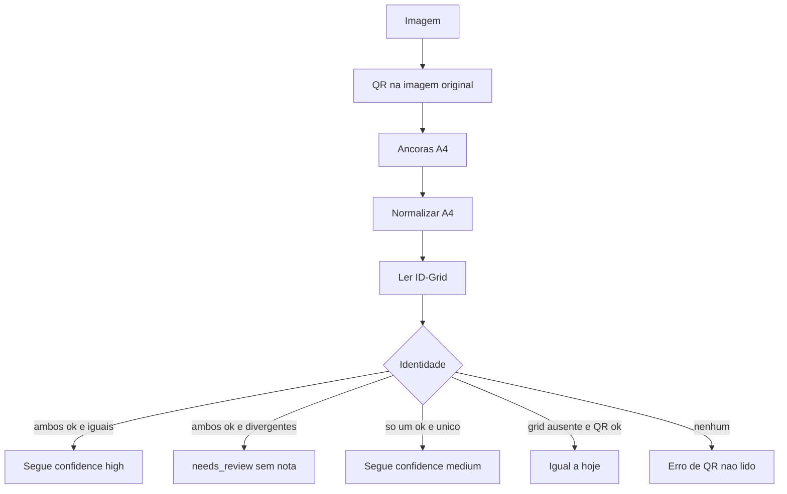

# ID-Grid de 12 caracteres no cartão OMR

O plano da outra IA não é implementável como está. Três premissas divergem do código real. O desenho abaixo substitui essas premissas e segue o que você pediu: no máximo 12 caracteres, faixa **depois** do cabeçalho, QR intacto, só backend, sem coluna nova.

## O que o plano original erra

- O PDF oficial não nasce do HTML por aluno. O miolo WeasyPrint é renderizado **uma vez**; nome, escola, turma e o QR real são pintados depois, no overlay ReportLab ([answer_sheet_generator.py](afirmeplay_backend/app/services/cartao_resposta/answer_sheet_generator.py) `_generate_student_overlay_pdf`, e o equivalente em [institutional_test_weasyprint_generator.py](afirmeplay_backend/app/services/institutional_test_weasyprint_generator.py)). Bolhas preenchidas no contexto Jinja sairiam iguais para todos os alunos. O `encode()` tem de alimentar o overlay.
- Não há retângulo livre no cabeçalho de 6,4 cm. Nome longo não empurra a altura (`white-space: nowrap` + reticências). A folga, com o conteúdo empilhado no topo, é ~0,96 cm. Uma grade de 4 linhas não cabe ali sem cortar nome ou assinatura.
- [pdf_generator.py](afirmeplay_backend/app/physical_tests/pdf_generator.py) e [libQr.py](afirmeplay_backend/app/test_correction/libQr.py) não geram nem leem esse QR. Não serão alterados. O QR atual é JSON `{"student_id","gabarito_id"}` no cartão e `{"student_id","test_id"}` na prova, prefixo de 12 caracteres **com hífen**.

## O que a medição do CSS confirma

Folha OMR: `29,7 = 1,2 (padding) + 6,4 (cabeçalho) + 3,8 (instruções) + 2,6 (aplicador) + 13,5 (grade) + 2,2 (padding inferior)`. Uma página por aluno para qualquer N (o cartão tem `overflow: hidden`; 2, 26, 52 e 104 questões não abrem página). Na prova física, os enunciados paginam à parte; o cartão é sempre a última página.

IDs de `Student`, `AnswerSheetGabarito` e `Test` são `db.String` com `str(uuid.uuid4())`, não coluna UUID nativa. Os 12 primeiros caracteres do QR são `8 hex + hífen + 3 hex`.

A posição Y do aplicador (`APPLICATOR_AUSENTE_CY_PX = 1474`) e a dos fiduciais de bloco somam o mesmo 3,8 cm das instruções. Se a faixa nova e a caixa de instruções **continuarem somando 3,8 cm**, aplicador, fiduciais, bolhas de resposta, âncoras e QR não se movem. A leitura de respostas, de “Aluno ausente” e de âncoras A4 não muda de constante.

Os triângulos do grid não entram no pipeline (`_detect_grid_triangles` não é chamado). A busca de fiducial é ±0,9 cm em torno do bloco, bem abaixo do cabeçalho. Marcadores da faixa não caem nessa janela nem nos 10% dos cantos (a faixa fica ~7,6 cm abaixo do topo da página).

## Payload (12 caracteres, não 18)

`K DDDDD SSSSS C`

- `K`: `1` gabarito (cartão), `2` prova física
- `D`: 5 primeiros hex do UUID do documento, sem hífen
- `S`: 5 primeiros hex do UUID do aluno
- `C`: checksum, 1 nibble

Checksum: `sum((i + 1) * nibble_i for i in 0..10) % 16`, impresso como hex. Troca de coluna ou 1 bit invertido falha o checksum. Sem separação clara de bolhas ou checksum ruim, a leitura é inválida. Nunca se “adivinha”.

Hex impresso em maiúsculas. A busca no banco é case-insensitive, porque o UUID guardado é minúsculo e `_resolve_qr_id` usa `startswith` sensível a maiúsculas. Função nova, sem mudar a assinatura de `_resolve_qr_id`.

Limite de colisão, inevitável com 20 bits por id: numa cidade com milhares de alunos, dois UUIDs podem compartilhar 5 hex. Prefixo ambíguo cruza com o QR; se continuar ambíguo, `needs_review`, sem nota. Menos de 12 caracteres piora isso, então o código usa os 12, não menos. A correção em lote **não** recebe o gabarito no pedido: prova e aluno precisam estar na faixa quando o QR falha.

Cada caractere = 1 coluna de 4 bolhas (8-4-2-1). Bolha pintada = bit 1.

## Onde a faixa entra

Entre o cabeçalho e as instruções, nos dois templates. Altura alvo ~1,75 cm. A caixa de instruções passa de 3,8 cm para ~2,05 cm, com texto encurtado para caber (título, poucos itens de uma linha, exemplos correto/incorreto). Soma permanece 3,8 cm.

Geometria mínima da faixa: diâmetro ≥ 3 mm, passo ≥ 3,8 mm, 12 colunas, quadro com o hex em cima de cada coluna, rótulo “USO DO SISTEMA — NÃO PREENCHER”, quadrados sólidos nas extremidades só para realinhar a faixa. Isso é um pouco abaixo do passo de 4 mm do plano antigo; 4 mm em 4 linhas não cabe nos 3,8 cm das instruções sem empurrar o aplicador.

O `
` da faixa no HTML fica vazio (só reserva altura). Quadros, bolhas e marcadores são desenhados no overlay, nas mesmas coordenadas nos dois geradores. Com a flag desligada, o template volta à caixa de 3,8 cm e o overlay não desenha nada: PDF idêntico ao de hoje.

Flag em [config.py](afirmeplay_backend/app/config.py), no mesmo estilo de `OMR_DEBUG`: `ID_GRID_ENABLED`, default ligada (`ID_GRID_ENABLED=0` desliga).

## Leitura

Nova `_read_identity_grid(img_a4)` em [correction_new_grid.py](afirmeplay_backend/app/services/cartao_resposta/correction_new_grid.py), constantes `IDGRID_*` próprias. Reutiliza `_build_ink_strength_map` e `_bubble_mark_features` sem editá-los. Limiar bimodal (Otsu) só nas 48 bolhas da faixa; separação mínima obrigatória.

Ordem em `corrigir_cartao_resposta`: QR, âncoras, A4, ID-Grid. QR ausente não aborta mais. ID-Grid ausente (cartão já impresso) não é erro: segue só com o QR. Os dois inválidos: a mensagem atual de QR não lido. `QrEntityNotFoundError` e o filtro de tenant permanecem.

Matriz:

- QR e faixa válidos e iguais: segue, `identity_confidence="high"`
- Válidos e divergentes: não chama `salvar_resultado`, `status="needs_review"`, `needs_review_reason="identificadores_divergentes"`
- Só um válido, prefixo único: segue, `identity_confidence="medium"`, `identity_source="qr"` ou `"idgrid"`
- Nenhum: erro atual

Campos só no dict (não há coluna): `identity_source`, `identity_confidence`, `idgrid_checksum_ok`, `identity_mismatch`. Repassados no JSON das rotas de correção do cartão e da prova física, sem mudança de frontend. `salvar_resultado` continua lendo só nota e respostas.

Debug (`self.debug`): overlay da faixa com bolhas e nibbles.

## Arquivos

- Novo [identity_grid.py](afirmeplay_backend/app/services/cartao_resposta/identity_grid.py): `encode` / `decode` puros, mais o desenho ReportLab usado pelos dois overlays
- Novo teste unitário do encode/decode (ida e volta, nibble 0 e F, coluna trocada, 1 bit invertido)
- [answer_sheet.html](afirmeplay_backend/app/templates/answer_sheet.html) e [institutional_test_hybrid.html](afirmeplay_backend/app/templates/institutional_test_hybrid.html): slot + instruções mais curtas, só com a flag
- [answer_sheet_generator.py](afirmeplay_backend/app/services/cartao_resposta/answer_sheet_generator.py) e [institutional_test_weasyprint_generator.py](afirmeplay_backend/app/services/institutional_test_weasyprint_generator.py): uma chamada de desenho no overlay, sem mexer em `QR_X` / `QR_Y` / `QR_SIZE` nem nos Y do nome
- [correction_new_grid.py](afirmeplay_backend/app/services/cartao_resposta/correction_new_grid.py): função nova + trecho de `corrigir_cartao_resposta`. Sem alterar V2, B1–B3, C1–C3, `FILL_THRESHOLD`, âncoras, fiduciais, aplicador
- [config.py](afirmeplay_backend/app/config.py): a flag
- JSON de resposta em [answer_sheet_routes.py](afirmeplay_backend/app/routes/answer_sheet_routes.py) e [physical_tests/routes.py](afirmeplay_backend/app/physical_tests/routes.py): só repassar os quatro campos

Fora: frontend, mobile, migrations, `libQr.py`, `pdf_generator.py`, `correction_n.py`, `correcao_hybrid.py`.

## Aceite

- Página OMR continua 1 para N = 2, 26, 52 e 104. Enunciados da prova não mudam de paginação.
- Diff de pixel: zero fora da faixa vertical que vai do fim do cabeçalho ao topo do aplicador (faixa nova + texto de instruções reescrito). QR, cabeçalho, âncoras, aplicador e bolhas de resposta iguais.
- Scans atuais sem a faixa: mesmas respostas, mesmo ausente, mesmas âncoras e blocos.
- Marcadores da faixa não disparam `_detect_a4_anchors` nem `_detect_blocks_via_fiducials`.
- Suíte sintética (rotação ±3°, perspectiva, blur, ruído, luz desigual, 1-bit, 150 e 300 DPI, bolha riscada): falso positivo de identidade = 0.
- Casos: QR+faixa ok; QR ilegível+faixa ok; QR ok+faixa ausente; divergentes; prefixo ambíguo; checksum inválido; prova física (`test_id`).

Antes de fixar o diâmetro em código, um PDF de prova é renderizado a 300 DPI para confirmar que o slot mede ~1,75 cm e que o aplicador não desceu. Se a medida divergir, paro e reporto. Não há como cumprir o critério antigo de “zero pixel fora só do retângulo da faixa”, porque o texto das instruções precisa encolher para a soma continuar 3,8 cm.
